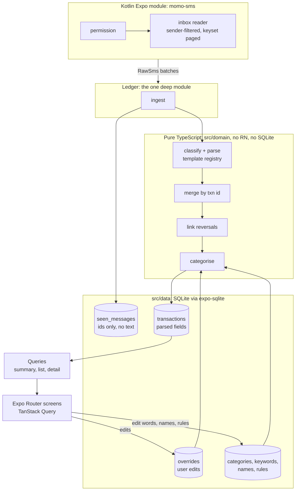
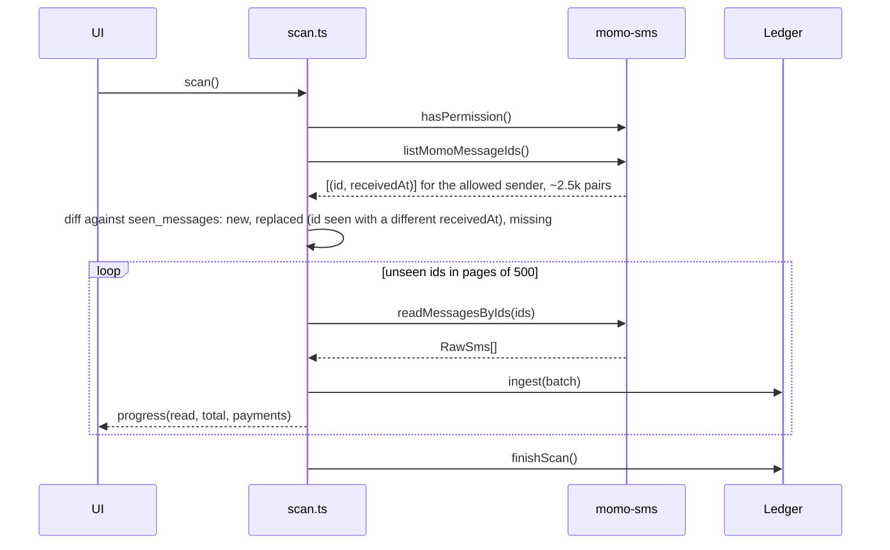

# System design (POC)

Status: draft for sign-off. Read with `spec.md` (what), `categorisation.md` (rules) and `design.md` (screens). This doc covers how it is built: structure, data, pipelines, tooling. No code exists yet.

## 1. Constraints that shape everything

- Android only, sideloaded APK, Expo dev build with one custom Kotlin module.
- Local only. No backend, no network calls. The Go sync service is out of scope here and the design leaves room for it, nothing more.
- Money is integer pesewas end to end. No floats, ever.
- The SMS wording will change. The design must make "fix the parser, history gets fixed" cheap.
- The user's manual choices must survive any re-parse or re-categorisation.
- Ingestion is idempotent: scanning the same inbox twice changes nothing.
- First import of ~2,500 messages under 10 s; incremental scan under 1 s.
- Commits follow Conventional Commits (section 12).

## 2. Architecture in one picture



Three rules hold the whole thing together:

1. **The phone's SMS inbox is the log. We do not copy message text.** The app stores only the parsed fields, plus a list of message ids it has already seen (`seen_messages`: id, status, transaction id; no text). To re-parse, it re-reads the inbox by id. When the original text is needed (the "Original message" row, the unread list), it is read live from the inbox and never saved.
2. **User edits live in their own tables** (`overrides`, `keywords`, `name_lists`, `recipient_rules`), keyed by `momo_txn_id` or by value, so a re-parse or re-categorisation cannot lose them.
3. **The domain is pure.** Parsing, merging, reversal linking and categorising take plain values and return plain values. SQLite and the native module are at the edges.

Consequence of rule 1: `transactions` is now durable data, not a throwaway projection. If the user deletes an old SMS, its transaction stays. A re-parse can only improve a transaction while its source message still exists on the phone, and it never deletes one.

## 3. Design alternatives considered

| | A. Mutate transactions directly | B. Inbox is the log, parsed fields stored (chosen) | C. Parse on every read |
|---|---|---|---|
| Idea | Parse an SMS, insert or update the `transactions` row, done | Parse by pure functions, store only parsed fields and the ids of messages seen. The phone's inbox stays the record of the text | Keep a copy of every SMS, parse in memory when screens load |
| Parser fix reaches old data | No, needs a migration script per fix | Yes, while the SMS is still on the phone: re-read by id and re-parse | Yes, but only because it copies every message |
| User edits survive | Only if every writer remembers to preserve them | By construction (separate tables) | By construction |
| Read speed | Fast | Fast (indexed SQL aggregates) | Slow, and summaries can't be done in SQL |
| Idempotency | Needs care in every code path | One place: unique `android_sms_id`, merge keyed on `momo_txn_id` | Trivial |
| Cost | Cheap now, expensive at the first format change | One small id table and a re-parse function | Rejected: copies message text, breaks SQL totals and the 1 s budget |

B keeps the pure, replayable parser of the log-based idea without storing any message text. The cost is that a re-parse needs the original SMS to still be on the phone. That is acceptable: a transaction already parsed stays, and the user's real inbox is the safety net. A is the shape most apps start with and the one that hurts at the first MTN wording change. C was rejected because it copies message text (a privacy cost) and because the summary screen needs SQL aggregation.

## 4. Repository layout

```
momo-spend/
  src/app/                     expo-router (the Expo template keeps routes under src/app): (tabs)/index, transactions, insights, settings; transaction/[id]; category/[id]; modals
  modules/momo-sms/            local Expo module
    android/src/main/java/.../MomoSmsModule.kt
    src/index.ts               typed JS surface (section 8)
    expo-module.config.json
  src/
    domain/                    pure TS, 100% unit-tested, no react-native or expo imports
      money.ts                 Pesewas brand, parseAmount, format
      time.ts                  timestamp parsing: ISO body time, else received time. The "You have Paid" shape's 12-digit value is yyyy+dd+HH+mm+ss with no month; it is not parsed (see section 5 and categorisation of occurred_at_source)
      parse/                   normalize.ts, registry.ts, parse.ts, templates/*.ts (one file per shape)
      merge.ts                 mergeAll: pure, commutative fold of all fragments sharing a txn id
      reversal.ts              link reversals to originals
      categorise/              reference.ts, fuzzy.ts, resolve.ts, seed.ts
    data/
      db.ts                    Db interface + expo-sqlite adapter
      migrate.ts, migrations/  0001_init.sql, ...
      repos/                   rawSms.ts, transactions.ts, categories.ts, ...
      queries/                 summary.ts, list.ts, insights.ts (SQL + row types)
    ledger/                    ingest.ts, project.ts, recategorise.ts   (the deep module)
    scan/                      scan.ts: native batches -> Ledger, progress events
    features/                  home/, transactions/, insights/, settings/ (hooks + components)
    ui/                        tokens.ts and primitives (Chip, Row, Sheet, Button, Bars)
  fixtures/sms/                anonymised, one JSON file per shape
  docs/
```

Why this split: `src/domain` is the only part with the heavy correctness burden, so it has no dependencies and runs under plain Jest in Node. `src/data` is the only part that knows SQL. `src/ledger` is the only part allowed to write to both. Screens never touch SQL or the parser.

## 5. The domain, as types

Sketch only; names are the contract, bodies come later.

```ts
// money.ts
export type Pesewas = number & { readonly __brand: 'Pesewas' };
export function parseAmount(text: string): Pesewas | null;   // "GHS 103.00" | "GHS3" | "GHS 2.5" (250) | "10.00 GHS" | "1,240.50" | "0." ; "-" -> null
// null for the main amount makes the template fail (message becomes unparsed). Callers coerce null fee/tax to 0 only at the very end.
export function formatGhs(p: Pesewas): string;               // "GHS 1,240.50"

// parse/types.ts
export interface RawSms { androidId: string; sender: string; body: string; receivedAt: number }
export type MessageKind =
  | 'payment_out' | 'cash_out' | 'transfer_out'
  | 'payment_in' | 'cash_in' | 'interest' | 'refund'
  | 'reversal';

export interface ParsedFragment {
  momoTxnId: string;
  kind: MessageKind;
  direction: 'in' | 'out';
  amount: Pesewas;                   // the only amount that must be present
  fee: Pesewas | null;               // null = this message does not say; 0 = it says zero
  tax: Pesewas | null;
  balanceAfter: Pesewas | null;
  counterpartyName: string | null;
  merchantCode: string | null;       // "Merchant 033097" goes here, never in counterpartyName
  counterpartyNumber: string | null;
  reference: string | null;          // raw, uncleaned; cleaning happens in resolveCategory
  occurredAt: { at: number; source: 'body' | 'received' };
  receivedAt: number;                // for deterministic fold order
  androidId: string;
  template: { name: string; version: number };
}
export type IgnoreReason = 'otp' | 'promo' | 'no_txn_id' | 'withheld' | 'pin_notice' | 'failed';
export type ParseResult =
  | { status: 'parsed'; fragment: ParsedFragment }
  | { status: 'ignored'; reason: IgnoreReason }
  | { status: 'unparsed' };
export function parseSms(sms: RawSms): ParseResult;          // never throws

// merge.ts
// Pure fold over ALL fragments of one transaction id, sorted by (receivedAt, androidId). Commutative by construction:
//   amount, kind: must agree; a conflict keeps the first and sets `conflict`.
//   fee, tax, balanceAfter: non-null beats null.
//   occurredAt: source 'body' beats 'received'; among equals the earliest.
//   counterpartyName: a real name beats null; a name without digits beats one with digits; merchantCode is kept separately.
//   reference: non-empty beats empty.
export function mergeAll(fragments: ParsedFragment[]): MergedTxn;

// reversal.ts
export interface Link { reversalTxnId: string; originalTxnId: string }
export function linkReversals(txns: ProjectedTxn[]): Link[];

// categorise/resolve.ts
export interface CategoriserConfig {
  categories: Category[]; keywords: Keyword[]; names: NameEntry[]; rules: RecipientRule[];
}
export interface TxnFacts { kind: MessageKind; direction: 'in'|'out'; counterpartyName: string|null;
  counterpartyNumber: string|null; reference: string | null }
export interface Resolved { categoryId: CategoryId; source: 'manual'|'rule'|'keyword'|'default' }
export function resolveCategory(f: TxnFacts, manual: CategoryId | null, cfg: CategoriserConfig): Resolved;
```

Template registry: an ordered array of `Template { name, version, test(body): boolean, parse(body, sms): ParsedFragment | null }`.

`parseSms` classifies in this order, which the real export showed is a clean split (392 OTPs, 1,919 messages with a transaction-id label, 177 without either):
1. **OTP:** body starts with `<#>` (filtered in Kotlin too, section 8) → `ignored:otp`.
2. **No transaction-id label** (`Transaction ID`, `Transaction Id`, `Financial Transaction Id`, lowercase `transaction ID`, case-insensitive; never `External …`) → `ignored:no_txn_id`. This takes all promos, outage notices, "withheld" and "airtime recharge received" notices out of the unparsed list in one rule.
3. **Failed:** body has a transaction-id label and `has failed` → `ignored:failed`. Shape 2's `test()` requires `has been completed`, so a failed payment can never be counted as spend. (6 in the export; they carry an id, no balance, and no money moves.)
4. **Templates**, in order. A labelled body that matches none is `unparsed`.

A labelled body is never ignored by a promo rule. Curly apostrophes are normalised to `'` before matching (`Y’ello` appears).

**Parse rate** for the 95% target = `parsed / messages with a transaction-id label`. Ignored and unparsed counts are reported separately.

## 6. Data model

> Superseded by [`data-model.md`](data-model.md) and `src/data/migrations/0001_init.ts`. The SQL below is the original sketch and no longer matches the schema.

SQLite, `PRAGMA user_version` for migrations, `PRAGMA foreign_keys = ON`, WAL mode. All money INTEGER pesewas, all times INTEGER epoch milliseconds UTC. Ghana is UTC+0 with no daylight saving, so body timestamps are parsed as UTC and month boundaries are UTC.

```sql
-- one row per message we have looked at. No message text is stored here.
CREATE TABLE seen_messages (
  android_sms_id   INTEGER PRIMARY KEY,         -- Android reuses ids after the newest SMS is deleted, so a row
  received_at      INTEGER NOT NULL,            --   whose received_at differs from the inbox's is a DIFFERENT message and is replaced
  status           TEXT NOT NULL CHECK (status IN ('parsed','unparsed','ignored')),
  ignore_reason    TEXT,                        -- otp | no_txn_id | failed | withheld | pin_notice | error:<code>
  template_name    TEXT, template_version INTEGER,
  parser_version   INTEGER NOT NULL,            -- re-parse picks rows older than the code's PARSER_VERSION, ignored rows included
  momo_txn_id      TEXT                         -- set when parsed
);
CREATE INDEX seen_txn ON seen_messages(momo_txn_id);
CREATE INDEX seen_status ON seen_messages(status);

CREATE TABLE categories (
  id INTEGER PRIMARY KEY, name TEXT NOT NULL UNIQUE, color TEXT NOT NULL,
  system_key TEXT UNIQUE,                       -- 'family','friends','cash','income','misc','airtime',... NULL for user categories.
  is_system INTEGER NOT NULL DEFAULT 0,         --   Rules and defaults resolve by system_key, so renaming a category cannot break them.
  sort INTEGER NOT NULL DEFAULT 0, created_at INTEGER NOT NULL);
CREATE TABLE keywords (
  id INTEGER PRIMARY KEY, category_id INTEGER NOT NULL REFERENCES categories(id) ON DELETE CASCADE,
  value TEXT NOT NULL, is_alias INTEGER NOT NULL DEFAULT 0, UNIQUE (value));
CREATE TABLE name_lists (
  id INTEGER PRIMARY KEY, kind TEXT NOT NULL CHECK (kind IN ('family','friend')),
  value TEXT NOT NULL, created_at INTEGER NOT NULL, UNIQUE (kind, value));
CREATE TABLE recipient_rules (
  id INTEGER PRIMARY KEY, match_field TEXT NOT NULL CHECK (match_field IN ('number','name')),
  match_value TEXT NOT NULL, category_id INTEGER NOT NULL REFERENCES categories(id) ON DELETE CASCADE,
  created_at INTEGER NOT NULL, UNIQUE (match_field, match_value));

-- user edits, keyed by the transaction id so a re-parse cannot lose them
CREATE TABLE overrides (
  momo_txn_id TEXT PRIMARY KEY,
  category_id INTEGER REFERENCES categories(id) ON DELETE SET NULL,
  reference   TEXT,                             -- user-entered note
  updated_at  INTEGER NOT NULL);

-- durable parsed data. Recomputed per transaction on re-parse, never bulk-deleted.
CREATE TABLE transactions (
  momo_txn_id TEXT PRIMARY KEY,
  kind TEXT NOT NULL, direction TEXT NOT NULL CHECK (direction IN ('in','out')),
  amount_pesewas INTEGER NOT NULL, fee_pesewas INTEGER NOT NULL, tax_pesewas INTEGER NOT NULL,
  balance_after_pesewas INTEGER,
  counterparty_name TEXT, counterparty_number TEXT,
  merchant_code TEXT,                           -- "Merchant 033097"; never stored as the name
  reference TEXT,                               -- RAW reference from the SMS; cleaned inside resolveCategory, user text lives in overrides
  reference_source TEXT NOT NULL CHECK (reference_source IN ('sms','user','none')),
  category_id INTEGER NOT NULL REFERENCES categories(id) ON DELETE RESTRICT,  -- deleting a category goes through deleteCategory() (7.8)
  category_source TEXT NOT NULL CHECK (category_source IN ('manual','rule','keyword','default')),
  is_self_transfer INTEGER NOT NULL DEFAULT 0,
  source_missing INTEGER NOT NULL DEFAULT 0,    -- set when the original SMS can no longer be read
  reversed_by TEXT,                             -- momo_txn_id of the reversal, if linked
  link_confidence TEXT CHECK (link_confidence IN ('exact','ambiguous')),  -- on the reversal row
  conflict INTEGER NOT NULL DEFAULT 0,          -- two messages disagreed on amount or kind; shown in the debug view
  occurred_at INTEGER NOT NULL, occurred_at_source TEXT NOT NULL,   -- 'body' | 'received' (about 71% of rows are 'received')
  template_name TEXT NOT NULL, template_version INTEGER NOT NULL);
CREATE INDEX txn_time ON transactions(occurred_at DESC);
CREATE INDEX txn_cat_time ON transactions(category_id, occurred_at);

CREATE TABLE meta (key TEXT PRIMARY KEY, value TEXT NOT NULL);
-- keys: parser_version, seed_version, first_import_done, first_import_at, owner_name, owner_number (normalised, last 9 digits)
```

Changes from the spec's model, all deliberate:
- `transactions` is keyed by `momo_txn_id`, with no surrogate `id`. Every lookup is by that key anyway.
- `overrides` is new. The spec put manual tags on the transaction row.
- `keywords` is a table, not an array column, so edits are row-level.
- `sync_state` becomes `meta`, a plain key-value table. It also holds `parser_version`, the number that triggers a re-parse (section 7.3).
- `raw_sms` is replaced by `seen_messages`, which holds ids and statuses and no message text. The spec's "raw SMS kept for debugging" requirement is dropped on purpose, for privacy; the same information is read live from the inbox when needed.
- `sms_id` on the transaction is replaced by the join to `seen_messages` via `momo_txn_id`.

Totals are SQL, not JS, and there are exactly three named queries in `queries/summary.ts`, each with a test. Refunds are treated like reversals, never as income (this supersedes spec section 3 row 10 and `categorisation.md` rule 5 for refunds).

```sql
-- 1. SPENT (pesewas). Out rows that were not reversed, PLUS the fee and tax of reversed rows
--    (a reversal credits only the amount: verified on all 6 in the export), MINUS reversals/refunds with no linked original.
SELECT COALESCE((SELECT SUM(amount_pesewas + fee_pesewas + tax_pesewas) FROM transactions
                 WHERE direction='out' AND reversed_by IS NULL AND kind NOT IN ('reversal','refund')
                   AND occurred_at >= :start AND occurred_at < :end),0)
     + COALESCE((SELECT SUM(fee_pesewas + tax_pesewas) FROM transactions
                 WHERE direction='out' AND reversed_by IS NOT NULL AND occurred_at >= :start AND occurred_at < :end),0)
     - COALESCE((SELECT SUM(r.amount_pesewas) FROM transactions r
                 WHERE r.kind IN ('reversal','refund') AND NOT EXISTS (SELECT 1 FROM transactions o WHERE o.reversed_by = r.momo_txn_id)
                   AND r.occurred_at >= :start AND r.occurred_at < :end),0);

-- 2. IN: kinds payment_in, cash_in, interest only. Reversals and refunds are never income.
SELECT SUM(amount_pesewas) FROM transactions
WHERE direction='in' AND kind IN ('payment_in','cash_in','interest') AND occurred_at >= :start AND occurred_at < :end;

-- 3. FEES AND TAX paid: every out row, including reversed ones.
SELECT SUM(fee_pesewas + tax_pesewas) FROM transactions
WHERE direction='out' AND occurred_at >= :start AND occurred_at < :end;
```

A reversal that lands in a later month changes the original's month (the original is excluded from that month's spend). That is a known, documented restatement of a past month, not a bug, and the hand-checked-month test includes a reversed payment.

## 7. Pipelines

### 7.1 Scan (on app open, and on "Check for new messages")



- **No date cursor.** Each scan lists the inbox's `(id, receivedAt)` pairs for the allowed sender (a few milliseconds for ~2.5k rows) and diffs them against `seen_messages`. Bodies are read only for ids that are new or whose `receivedAt` changed. This catches messages restored from a backup (they keep their old dates and get new ids), messages after a phone-clock jump, and deleted messages, none of which a date cursor sees. The first run is the same code with an empty `seen_messages`.
- **Reused ids.** Android can hand the id of a deleted newest message to the next SMS. A seen id whose stored `received_at` differs from the inbox's is treated as a new message and its row is replaced. Readers by id (detail, unread list, re-parse) also check that the returned message's `receivedAt` matches, and treat a mismatch as `source_missing`.
- **Ids cross the bridge as numbers.** They are compared as integers in Kotlin and SQLite (as text, `"999" > "1000"`).
- **Triggers:** cold start, return to the foreground (`AppState` becomes `active`, which covers the usual flow of paying by USSD and coming back to a warm app), the foreground observer, and the manual button. All go through the single-flight scan (7.7).
- A failure mid-scan loses nothing: each batch commits atomically with its `seen_messages` rows, and the next scan simply diffs again.

### 7.2 Ingest (the idempotent core)

`ingest(batch)` runs in one exclusive SQLite transaction, with a **savepoint per message**:

1. For each message in the batch, in memory: `parseSms` gives `parsed`, `unparsed` or `ignored`. The body is used here and then dropped; it is never written anywhere.
2. Upsert the message's id, `received_at`, status and `parser_version` into `seen_messages` (a replaced id overwrites its row).
3. For each parsed message, collect the fragments of its transaction id: this message's, plus the stored row's own fields as an extra fragment. Fold them all with `mergeAll`. Then load the override if any, run `resolveCategory`, and upsert one `transactions` row.
4. If any statement for a message fails, roll back to that message's savepoint, record the message as `unparsed` with `ignore_reason = 'error:<code>'`, and carry on. One bad message can never block the batch or make every later scan fail on it. The count of error rows is visible under Settings, "Messages we couldn't read".

`mergeAll` is a pure, commutative fold with per-field precedence (section 5), not "fill empty". The real data needs this: the two messages of one transaction disagree on the counterparty in 102 of 273 pairs (80 cross-shape pairs name the merchant in one and `Merchant NNNNNN` in the other), one shape has no Tax field at all (a non-zero tax in the other message is lost in 3 pairs if absent is treated as zero), and the shape that arrives first has a wrong time in 20 of 80 pairs. A property test ingests every pair in both orders and asserts the same row.

### 7.3 Re-parse and recategorise

- `reparse()` is the normal scan run in "reparse mode": it re-reads, by id and in pages, every `seen_messages` row that is `unparsed`, `ignored`, or has a `parser_version` older than the code's (ignored rows are included, so an over-broad ignore rule can be corrected), runs them through the current parser, and re-folds the affected transactions. Manual overrides are untouched. A message that is no longer on the phone is skipped, and its transaction keeps what it has. No new native call is needed.
- Trigger: `meta.parser_version` is compared with the `PARSER_VERSION` constant in code. Bumping the constant whenever a template changes causes a re-parse at next app start, behind the Importing screen if it is large. A "Re-read messages" action in Settings does the same by hand.
- Re-parse recomputes a transaction as `mergeAll` over the fragments of every one of its messages still on the phone, so a field a past parser got wrong (for example a wrong amount) is corrected. Fields whose only source message is gone keep their stored values; the stored row joins the fold as the lowest-precedence fragment. This replaces the earlier "re-parsed fields win" wording, which contradicted "never overwrite".
- Re-parse is resumable: `meta.parser_version` is written only after the last page commits.
- `recategorise()` re-runs only `resolveCategory` for rows whose `category_source` is not `manual`. It runs after the user edits keywords, names or rules, inside one transaction, so the Home screen never shows a half-updated state.
- Both are bounded: ~2,500 rows, one transaction, well under the 10 s budget.

### 7.4 Reversals and refunds

The data shows the reversal message carries its own transaction ID, not the original's. I checked all 6 reversals and refunds in the sample export against the other transaction IDs: none matched. So linking cannot use the ID.

`linkReversals` matches a reversal or refund to an earlier outgoing transaction. Exact name equality failed on the real data (refunds never matched, reversals had 2 to 5 candidates, and names differ across shapes: `MTN BUNDLE` vs `MTNBUNDLE`, `Other Networks (one4all.sp)` vs `Other Networks`). So:

- **Names are normalised** before comparing: casefold, keep letters only, drop a trailing `(…)` or `. (…)` suffix. Equal after that, or one is a prefix of the other.
- **Window: 30 days** (MTN's own notices say "within 15 days"; one reversal came 12 days after its payment).
- **Candidate:** out rows with the same amount, not already reversed, earlier than the reversal. Pick the **closest** one. If more than one candidate qualifies, link the closest and set `link_confidence = 'ambiguous'`. Totals can differ across a month boundary, so ambiguity is flagged, not hidden.
- It runs in `finishScan` over **all** unlinked reversal and refund rows (a few dozen at most), not only new ones. A crash between batches and `finishScan` therefore cannot leave a reversal unlinked for good.

- **Linked:** the original gets `reversed_by`, drops its amount from spend (its fee and tax stay, since the reversal credits only the amount), and shows struck through. The reversal row is never income.
- **Unlinked:** shown in the list with "Reversed, original not found", and its amount reduces that month's spend (query 1 in section 6).

### 7.5 When the user deletes a message

Everything the app calculates is written to SQLite when the message is ingested, so deleting the SMS later loses nothing the screens use. Specifically:

- **Parse results are committed with the seen-message rows, so a message is never marked seen without its result being saved.** A batch's `transactions` and `seen_messages` rows are written in one SQLite transaction. The app never holds a parsed value only in memory.
- **Every derived value is stored**: amount, fee, tax, balance, counterparty, the cleaned reference, the category and its source, the self-transfer flag, and the reversal link. Nothing is recomputed from the SMS at read time.
- **Totals and charts come from SQL over stored rows** (`SUM`, `GROUP BY`), so they are correct whether or not any SMS still exists.
- **Recategorising never needs the message.** `resolveCategory` takes the stored fields, so editing keywords, names or rules works the same after the inbox is cleared.
- **A missing message is never a reason to delete or edit a transaction.** Only the two features that show the text, and the re-parse, depend on the inbox.

The only visible effects are on those features. The scan's id diff (7.1) already knows which seen ids are no longer in the inbox, so `finishScan` sets `transactions.source_missing = 1` for their transactions at no extra cost, and the detail screen shows "The original message is no longer on this phone". `readMessageById` returning `null` or a message with a different `receivedAt` sets the same flag. A re-parse skips such transactions.

### 7.6 Listening for new messages

Android has no operating-system filter by sender. A background receiver (`SMS_RECEIVED`) needs the separate `RECEIVE_SMS` permission and is called for every incoming SMS from every sender; the app can only look at the sender after the fact and discard the rest. That is a much bigger privacy claim than the query we use now, which only ever fetches `MobileMoney`. It also needs a headless task to write to SQLite while the app is closed.

Plan:
- **POC:** scan on app open, plus a `ContentObserver` on the SMS provider while the app is in the foreground. When a MoMo message arrives with the app open, the observer triggers an incremental scan (under 1 s), so the screen updates live. This needs only `READ_SMS`, and still reads only the MobileMoney sender.
- **Later (out of scope, as the spec says):** a background `SMS_RECEIVED` receiver for notifications and refresh while closed. It adds the `RECEIVE_SMS` permission and a stricter Google Play review.

### 7.7 One writer at a time

Five things write: scan on open, the foreground observer, the manual "Check for new messages", `reparse()`, and `recategorise()` (plus user edits). expo-sqlite's `withTransactionAsync` is not exclusive: other queries on the same connection run inside an open transaction, and a second `BEGIN` fails. A payment that arrives during the first import would otherwise fail or corrupt it. The observer also fires several times per SMS (any sender, read-flag updates, and the two messages each payment produces 1 to 200 s apart).

- All ledger writes go through **one in-process single-flight queue** in `src/ledger`. A scan requested while one runs sets a "rerun once" flag instead of starting a second.
- The observer callback is **debounced (about 1 s)**.
- Every batch, `recategorise`, `reparse` and user edit uses `withExclusiveTransactionAsync`. `PRAGMA foreign_keys = ON` is set on every connection open, in `db.ts`.
- A test fires two concurrent `scan()` calls and an edit in the middle of a scan, and asserts a consistent end state.

### 7.8 Deleting a category

`deleteCategory(id)` is a ledger function, not a raw DELETE. System categories (those with a `system_key`) cannot be deleted. For a user category, in one transaction: move its transactions to Misc, delete the `overrides` rows that pointed at it (so no stale `manual` remains), delete its keywords and any recipient rules for it (after a confirmation that shows the counts, because those cascade), delete the category, then `recategorise()` the moved rows. Family and Friends name lists resolve through `system_key`, so renaming the categories does not break them.

### 7.9 Backup import

A second source for the first load, feeding the same `ingest(batch)` as the scan (7.2).

- **Input.** The user picks an SMS Backup & Restore XML file through the system document picker (`expo-document-picker`, copied to cache and deleted after). The reader streams it in chunks, so a 2.4 MB file (or a much larger one) never sits in memory as a string, and keeps only `<sms>` elements whose `address` is `MobileMoney`. Other senders are skipped before their body is read into a message object.
- **Fields.** `body`, `date` (epoch ms, the received time) and `address`. The export has no Android `_id`, so identity cannot be `(android_sms_id, received_at)`.
- **Identity.** `sms_messages` has `source` (`inbox` or `backup`); `android_sms_id` is NULL for `backup` rows, which carry a `backup_key` instead: `<received_at>:<momo_txn_id>:<template_name>`, unique among backup rows. `(received_at, momo_txn_id)` alone is not enough because `sms_messages` has no txn id column and the importer builds the key from the parse result; the template name separates two fragments of one payment that share a millisecond. Re-importing the same or a newer backup hits the same keys and converges. A backup message that parses as unparsed or ignored is counted for the Importing screen but is not stored, because it has no stable identity (a CHECK keeps backup rows `parsed`). `gone_at` never applies to backup rows, `source_on_phone` is false for transactions whose fragments are all from a backup, and `unread_messages` lists inbox rows only.
- **Overlap with the scan.** When the user later grants SMS access, the scan reads the inbox and its fragments join the same transactions by `momo_txn_id`; `mergeAll` is commutative, so the result does not depend on which source arrived first. Old messages the phone still holds simply add inbox fragments next to the backup ones.
- **Progress.** The same events as the scan (`read`, `total`, `payments`) drive the Importing screen. The total comes from a first counting pass over the `address` attributes.
- **Privacy.** The file is read once, no text is stored, and the cached copy is deleted when the import ends or fails. Importing never needs `READ_SMS`.
- **After the import.** `meta.first_import_done` is set, then Home asks once for SMS access. If the user declines, new payments need a fresh import, and Home shows the "SMS access is off" banner with an "Import a newer backup" action.

## 8. Native module contract

`modules/momo-sms` is a local Expo module (`create-expo-module --local`). The JS surface is small and stateless:

```ts
export interface InboxRef { androidId: number; receivedAt: number }                 // ids are numbers, never strings
export interface RawSmsRow { androidId: number; sender: string; body: string | null; receivedAt: number; isOtp: boolean }
                                                                                    // body is null when isOtp: OTP text never reaches JS

export function hasPermission(): Promise<boolean>;
export function requestPermission(): Promise<'granted' | 'denied' | 'blocked'>;   // blocked = "don't ask again" OR Android 13+ restricted setting
export function listMomoMessageIds(opts: { senders: string[] }): Promise<InboxRef[]>;           // the scan's diff input; no bodies
export function readMessagesByIds(androidIds: number[]): Promise<RawSmsRow[]>;                   // chunks of 500; sender-filtered; re-parse, scan, unread list
export function readMessageById(androidId: number): Promise<RawSmsRow | null>;   // detail screen; null if deleted; caller checks receivedAt matches
export function addMomoMessageListener(cb: () => void): { remove(): void };      // ContentObserver, foreground only; carries no text; debounced in JS
```

Kotlin side: `AsyncFunction`s run off the main thread. `listMomoMessageIds` queries `content://sms/inbox` for `_id, date` with a case-insensitive selection on `address`. The by-id reads use `_id IN (…)` in chunks, re-apply the sender selection (so a reused or foreign id never leaks another sender's text), blank the body of any message starting with `<#>` (OTP, security codes) and return `isOtp = true`, and close the cursor in `use {}`. Only the allowed sender is ever read, so NFR-02 holds at the source, not just in JS. `requestPermission` uses the Expo permissions manager and distinguishes a plain denial from a permanent one so the "Permission denied" screen can send the user to phone settings.

**As built (`modules/momo-sms`).** The surface differs from the sketch above in these ways. `getPermissionStatus()` replaces `hasPermission()` and returns `'granted' | 'denied' | 'blocked' | 'undetermined'`. `listMomoMessageIds()` takes no options, because the allowed sender is a constant in Kotlin. `readMessageById` is not built yet. The debounce is about 1 s in Kotlin (`ContentObserver` plus `Handler.postDelayed`), and JS starts and stops the observer through the first and last listener. The sender is matched with `LIKE`, which is ASCII case-insensitive, and checked again in Kotlin. Details and the APIs used are in `modules/momo-sms/README.md`.

No keyset paging is needed now: the id list is cheap and bodies are read by id in chunks of 500, so a changing inbox cannot skip or repeat a page.

## 9. Application layer

- **Routing:** Expo Router. Tabs: Home, Transactions, Insights, Settings. Stack screens: `transaction/[id]`, `category/[id]`, `unread`. Sheets are modal routes.
- **Reads:** TanStack Query wrapping the `queries/*` functions. Query keys include the month (`['summary', '2026-10']`). The selected month and list filters live in router search params, so there is no global store. Zustand is not added.
- **Writes:** every mutation goes through a function in `ledger/` or a repo, then invalidates by key prefix (`['summary']`, `['transactions']`). Edits to keywords, names or rules call `recategorise()` first.
- **First run and permission states.** The root layout routes on data first, then permission, using `meta.first_import_done` (set when the first scan completes, not when seeding finishes):
  1. Database has transactions → Home. If the permission is now missing (Android 11+ auto-revokes unused apps), Home shows a "SMS access is off" banner over the stored data instead of hiding it.
  2. No data and no permission → Permission, or Permission denied.
  3. No data, permission granted, scan in progress → Importing.
  4. Permission granted but `listMomoMessageIds()` returns 0 → a distinct "We can't see any MobileMoney messages" screen. Some phones (MIUI, and Tecno/Infinix ROMs common in Ghana) hide alphanumeric-sender SMS until a separate "notification/service SMS" toggle is allowed, so a granted permission can still return nothing.
  5. `requestPermission()` returns `blocked`: the screen explains Android 13+ "restricted settings" for APKs installed from a browser or file manager (App info → ⋮ → Allow restricted settings, then grant SMS). ADB installs are exempt, so the developer never sees this; it is a manual test (step 1 of the build order).
- **Triggers:** cold start, `AppState` → `active`, the foreground observer and the manual button all call the same single-flight scan (7.7).
- **Needs a reference prompts** cover only transactions with `occurred_at >= meta.first_import_at` whose resolved category is Misc (and cash-outs, for the "What was this for?" sheet). The first import would otherwise raise about 700 prompts plus 134 cash-out prompts from old history; history stays reachable through the "Needs a tag" filter.
- **App lock (Should):** `expo-local-authentication` gate in the root layout, off by default.

## 10. Privacy and safety, enforced structurally

- **No network.** The release build strips the `INTERNET` permission through `app.config.js`, keyed on the EAS build profile (the dev client keeps it for Metro). A build with no network permission is a stronger guarantee than a promise.
- **No cloud backup.** `android:allowBackup="false"` and `dataExtractionRules` exclude the database.
- **Narrow reads.** The sender filter lives in Kotlin, including `readMessageById`, which refuses any message not from an allowed sender.
- **No message text is stored.** The app keeps parsed fields and message ids only. OTPs, promos and unknown messages are never copied. The "Original message" row and the unread list read the text live from the inbox and discard it. The one thing in the database that came from message text is the parsed fields (amount, counterparty name and number, the reference).
- **OTPs never reach JS.** The Kotlin reader returns `isOtp = true` with no body for `<#>` messages (392 of 2,488 in the sample), so they cannot leak through the bridge, `console.log` or logcat.
- **Logs carry ids and statuses only, never message text.** ESLint `no-console` applies to `domain`, `ledger` and `scan`, and release builds strip console calls.
- **Backup and recovery.** `allowBackup=false` means a reinstall or "Clear data" loses the user's edits and any transaction whose SMS is gone. POC mitigation: if the database fails to open or migrate, move the file aside, rescan the inbox and tell the user their edits were lost. Settings gets a small "Export data / Import data" (the SQLite file through the share sheet, no network), promoted from "Could" to "Should". Use one signing key for dev and release builds so an upgrade install keeps the data.
- **Migrations and seeds.** Each migration and its `user_version` bump run in one transaction. Seed data is versioned (`meta.seed_version`); a later seed adds rows with `INSERT OR IGNORE` and never re-adds a word the user removed or overwrites one they edited. Seed keyword duplicates are caught by a test, because `keywords.value` is UNIQUE.
- The database is not encrypted at rest in the POC. It is in app-private storage. SQLCipher is a later option if the sync backend is added.

## 11. Testing

| Layer | How | Gate |
|---|---|---|
| `domain/parse` | Jest in Node over `fixtures/sms/*.json` (≥5 per shape, anonymised). One test per fixture asserting every field | NFR-08: every fixture passes |
| `domain` money and time | Table tests plus property tests (random amounts round-trip through format and parse) | No float arithmetic anywhere (lint rule bans `parseFloat` on money) |
| `domain/categorise` | Table tests from `categorisation.md`: exact, one typo, swapped letters, name beats keyword, junk references | Cases written from the spec before the code |
| `data` and `ledger` | A `Db` interface with two adapters: `expo-sqlite` in the app, `better-sqlite3` in Jest. Same migrations, same SQL | Idempotency test: ingest the same batch twice, assert identical rows |
| Balance reconciliation | Synthetic sequence: each outgoing balance must equal the previous minus amount, fee and tax | Mirrors the real-data check from the analysis |
| Merge order | Property test: ingest every same-id pair from the fixtures in both orders and assert an identical row (covers name vs `Merchant NNN`, absent vs zero tax, wrong vs right time) | All 273 real pairs, anonymised |
| Ingest faults | A "throw after N statements" test on `ingest` (poison message: one bad row must not block the batch); two concurrent `scan()` calls; an edit during a scan; upgrade from migration N−1 with data | Gate for M3 |
| Id reuse and restore | Ledger tests that delete, reuse and restore ids (same id with a different `receivedAt` must be treated as new) | Gate for M3 |
| Native module | Manual on a real phone, plus an emulator inbox seeded from the anonymised fixtures with `adb shell content insert --uri content://sms/inbox --bind address:s:MobileMoney …` so restore, delete-newest and clock-skew cases can be scripted. Also install the release APK through a file manager on an Android 13+ phone (restricted settings) | M1 exit criterion |
| UI | Minimal `jest-expo` render tests for the screens with logic (needs-reference list, cash-out sheet) | Not a gate for the POC |
| Real-data check | A dev-only script runs the parser over a user-supplied XML export (the export has no `_id`, so the script assigns synthetic ids in file order and runs the messages through `Ledger.ingest` on `better-sqlite3`) and prints parse rate against messages with a transaction-id label, unparsed shapes, ignored counts and the reconciliation result | Target: ≥95% parse |
| Fixtures | One fixture per layout variant, not per shape (two "Payment made" layouts, trailing promo text present or absent, failed, reversal with its lowercase `transaction ID`, refund) | ≥5 per shape plus variants |

The domain package never imports `react-native` or `expo-*`, enforced by an ESLint `no-restricted-imports` rule. That is what keeps the fast tests possible.

## 12. Tooling and conventions

- **Language:** TypeScript with `strict`, `noUncheckedIndexedAccess`, `exactOptionalPropertyTypes`. Kotlin for the module only.
- **Package manager:** npm (fewest Metro surprises).
- **Styling:** NativeWind v4.2 (Tailwind CSS 3.4) with `className` on React Native components. The design tokens from `design.md` (ink, signal yellow, hairline, income, warn, radii, the 2px hard border) live in `tailwind.config.js`; `src/global.css` is imported once in the root layout. Class order is enforced by `prettier-plugin-tailwindcss`. Inter and Inter Tight load through `expo-font` in a later step.
- **Lint and format:** ESLint (typescript-eslint, `no-restricted-imports` for the domain boundary), Prettier.
- **Git hooks:** `lefthook` runs lint-staged, `tsc --noEmit` and domain tests on pre-commit, and `commitlint` on `commit-msg`.
- **Conventional Commits:** `type(scope): subject`, imperative, 72 characters. Types: `feat`, `fix`, `refactor`, `perf`, `test`, `docs`, `build`, `ci`, `chore`. Scopes: `sms`, `parser`, `ledger`, `db`, `categorise`, `ui`, `home`, `transactions`, `insights`, `settings`, `app`, `docs`. A parser template change is `feat(parser)` or `fix(parser)` and mentions the template name. Breaking schema changes use `!` and a migration note. Examples: `feat(parser): add cash-out template v1`, `fix(ledger): ignore reversal when original is unlinked`.
- **CI (GitHub Actions):** four jobs on every push to `main` and every PR. `static`: `tsc`, ESLint, Prettier check. `test`: Jest with coverage, failing under the domain thresholds (95% statements, functions and lines, 90% branches). `expo`: `expo-doctor` (validates `app.json` against the SDK schema and checks dependency versions) and `expo export --platform android` (proves Metro, Babel and NativeWind compile). `commits` (PRs only): commitlint over the PR's commits. Not yet in CI: a debug APK build (needs the Kotlin module and the Android SDK), and instrumented tests on an emulator.
- **Branching:** trunk-based; short branches; squash merges keep Conventional Commit titles.
- **Fixtures hygiene:** a script anonymises names, numbers and merchant names, remaps every transaction id consistently (keeping pair relationships), and shifts each fixture file's balances by one constant so reconciliation still holds but no real balance history or lookup id is committed. Amounts, fees and structure are kept. Raw exports are in `.gitignore` and never committed.

## 13. Performance plan

| Budget | Plan |
|---|---|
| First import of 2,500 messages under 10 s | 5 batches of 500; one SQLite transaction per batch; prepared statements; parsing is regex on short strings and costs milliseconds per message; the merge step touches only the affected transaction ids. Expected total: a few seconds. Measured in M3 on a mid-range phone, with the budget as a test |
| Incremental scan under 1 s | One id-list query (~2.5k small rows), an in-memory diff and usually zero or one small body read |
| Screen loads | Indexed SQL aggregates; no list holds more than one month; Transactions uses a `FlatList` with a fixed row height |
| Re-parse | Re-reads by id in chunks of 500 (`readMessagesByIds`, one provider query per chunk, not one per message) and updates in one transaction per chunk; expected a few seconds for 2,500 messages; runs behind the Importing screen only on a parser version bump |

## 14. Build order, as verifiable units

| Step | Deliverable | Proven by |
|---|---|---|
| 0 | Repo scaffold: Expo dev build, TS strict, lint, hooks, commitlint, CI | `npm test` passes on an empty domain; a commit with a bad message is rejected |
| 1 (M1) | `momo-sms` module, permission flow, raw message list on screen | Real phone lists MobileMoney messages only (no OTP bodies reach JS); denial and "blocked" both handled; the release APK installed through a file manager on an Android 13+ phone shows the restricted-settings path; delete the newest MoMo SMS, receive another, and it is still read (id reuse) |
| 2 | `money.ts`, `time.ts`, fixtures, first three templates | Fixture tests green |
| 3 (M2) | All shapes, classify-ignore, merge, `unparsed` | ≥95% on the real export script; merge test for a pair where one message says `Merchant NNNNNN` and the other names the merchant |
| 4 (M3) | `Db`, migrations, `Ledger.ingest` and `reparse`, scan, list and detail | Idempotency test; 2,500-message import under budget on the phone |
| 5 (M4a) | Categoriser, seed data, overrides, `recategorise`, needs-a-reference and cash-out flows | Categorisation table tests; 70% on the export |
| 6 (M4b) | Summary and Insights queries and screens | Hand-checked month matches to the pesewa |
| 7 | Settings: categories, words, names, unread messages, app lock | Edit a keyword and watch Home change |
| 8 | Reversal linking, polish, release build without `INTERNET` | `aapt dump permissions` or `npm run check:apk` shows no network permission |

Each step ends in something that runs. Design screens are already done, so steps 1 to 8 are implementation only.

## 15. Decisions and what was rejected

| Decision | Chosen | Rejected, and why |
|---|---|---|
| Storage model | Parsed fields stored, message ids tracked, the phone's inbox acts as the log | Mutating rows with no way back to the source; copying every SMS into our own table (privacy cost) |
| Live updates | Foreground `ContentObserver` plus scan on open | A background `SMS_RECEIVED` receiver now: needs `RECEIVE_SMS`, sees every sender's messages, needs a headless task |
| Data access | Raw SQL behind small typed repos and queries | An ORM: adds weight for a 7-table schema; revisit when a second schema consumer (Go sync) exists |
| Client state | TanStack Query plus router params | Zustand or Redux: nothing global to store |
| Parser shape | Ordered template registry, pure functions | One big regex per type: unreadable and untestable |
| Category storage | Computed and stored with `category_source`, recomputed on config change | Computing at read time: breaks SQL grouping |
| Paging native reads | Keyset cursor, 500 per batch | Offset paging (inbox moves under us), or one giant read (bridge payload) |
| Tests for SQL | Same migrations on `better-sqlite3` in Node | Mocking the database: hides the SQL bugs that matter here |
| Network | Strip `INTERNET` in release | A privacy policy sentence |

## 16. Risks and open questions

- **Reversal linking is a heuristic.** Normalised name, same amount, 30-day window, closest earlier; ambiguous matches are linked and flagged. It is tested on only 6 real reversals and refunds. Totals can shift by a month when the candidates straddle a month boundary.
- **`android_sms_id` reuse is unconfirmed on a device.** The AOSP provider table has no AUTOINCREMENT, so deleting the newest SMS can let the next one reuse its id. The design handles it (a seen id with a different `received_at` is a new message), but the first M1 test is to delete the newest MoMo message, receive another, and check it is read.
- **Deleted SMS.** If the user clears their inbox, parsed transactions stay but can no longer be re-parsed, and "Original message" shows "no longer on this phone". That is the price of not copying message text.
- **Expo New Architecture and custom modules.** Expo Modules API is the supported path and works with both architectures. Verify at scaffold time against the then-current SDK.
- **Sender variants.** Only `MobileMoney` appears in the sample. The `senders` option lets a second sender be added without a native change.
- **Fee semantics** are now checked across all shapes on the sample export: cash-out fees are on top (133 of 134), incoming fees are zero, and balances rise by exactly the amount on incoming, refund and reversal messages. This closes the earlier open risk.
- **Owner identity.** `is_self_transfer` needs the owner's name or number. Source: Settings, entered once, with numbers normalised to their last 9 digits. Shape 6's `account NNN` is a 9-digit internal account, not a phone number, and no message carries the owner's number reliably, so it is not inferred.
- **`MoMoApp` sender.** The export has 7 messages from a sender called `MoMoApp`. They were not read. Please look at them by hand; if they carry transactions, add the sender to the `senders` default.
- **Received time is the norm.** About 71% of financial messages have no time in the body, so `occurred_at` is the device's received time for most rows (`occurred_at_source = 'received'`). The UI marks these as approximate times. Messages are normally delivered within seconds (about 3 hours at worst in the sample), and the month is taken from that time.
- **Two wallets or a SIM swap.** `sub_id` changed once in the sample and is never used. A second MoMo wallet would break balance reconciliation; surface it, do not split it.
- **Second phone** is still needed to validate the 70% categorisation target.
- Open for you: project name (default `momo-spend`); whether the debug "run parser over an XML export" script lives in the repo (it is dev-only and the export itself is never committed).
